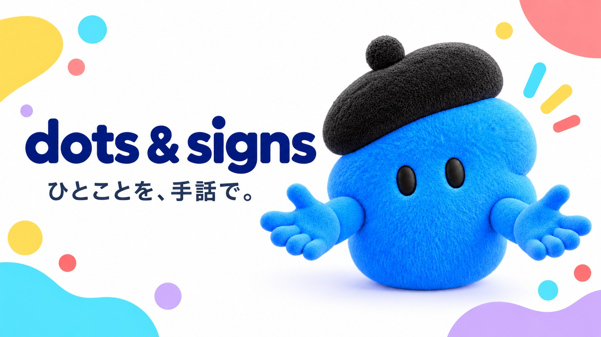
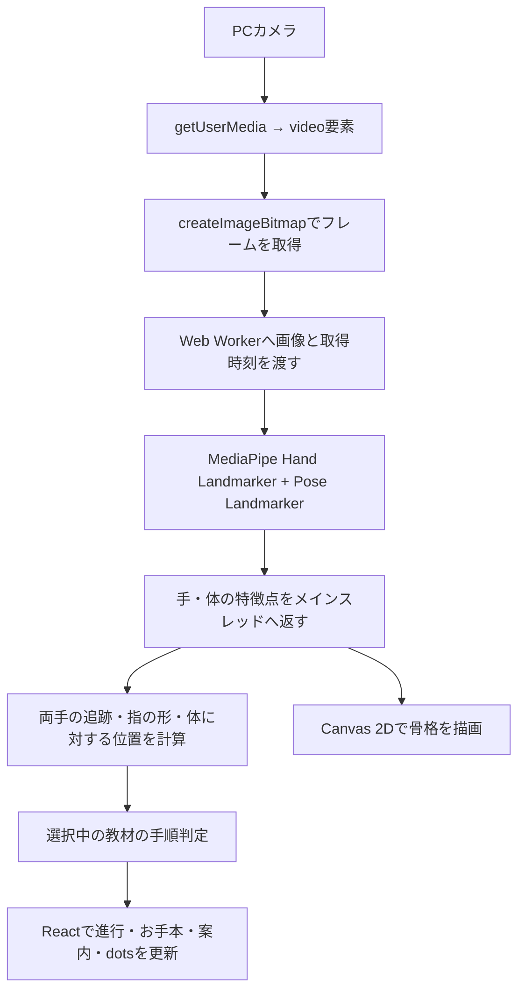

# Practice Signs with Dots



**ひとことを、手話で。** 青・緑・黄色・ピンクの4体のdotsと、「こんにちは」の手話を練習するDevDayアプリです。

[ChatGPT Site](https://practice-signs-with-dots.yurinakanishi33.chatgpt.site) · [GitHub](https://github.com/yurinakanishi/practice-signs-with-dots)

この版は **「こんにちは」だけを練習できる版** です。音声入力モードは **Coming Soon** と表示し、操作UIを非公開にしています。音声の内部処理・サーバー・利用回数制限は再開用に残しています。公開手順・検証状況は [docs/SITES.md](docs/SITES.md)、[引き継ぎ仕様](SPEC.md)・[音声の構成と検証](docs/LIVE.md)も参照してください。

ローカル版はサインイン不要です。ChatGPTサインインの連携やログイン用トークンの保存は実装していません。練習中のヒント選択と音声にはサーバー側のOpenAI APIキーを使います。

## 審査で主張できること

このプロトタイプが示すのは、**「お手本を見て終わり」ではなく、初心者が一つの手話表現を順番に練習できる体験**です。現在の対象は「こんにちは」の1表現です。次の点は実装とテストで裏付けられています。

| 主張 | 確認できる根拠 |
| --- | --- |
| カメラの前で3段階を練習できる | 手と体の特徴点を端末内で検出し、指の形・位置・動きの順序を独自の判定器で確認する。ステップごとの参考画像、必要な手の数、現在位置を表示する。 |
| つまずいても続きから練習できる | 完了済みの段階を判定器の状態として保持する。短い検出漏れやカメラの停止後も、同じページ内なら途中から再開できる。 |
| AIが練習状況に合わせて次の案内を選ぶ | 約12秒進行が止まると、Decisions APIが用意済みのヒント候補から選択する。成功判定と教材の文章はアプリ側で管理する。 |
| カメラ映像をAIへ送らずにヒントを出す | 手・体の推定はブラウザ内で実行し、ヒントのAPIには段階・検出数・停滞時間などの要約だけを渡す。 |
| 実際に試せる形まで作っている | 画面、ローカル起動、Sites向けビルド、205件の自動テストがある。公開URLの到達性と実カメラでの成功率は、提出前に別途確認する必要がある。 |

**デモで見せる順序:** お手本の3画像を確認 → カメラを許可 → ステップを進める → 途中で止めて再開位置を示す → 停滞時のヒントを示す。最後のヒントはAPIキー・利用枠・ネットワークに依存するため、提出前に実際の公開環境で動作を確認してください。4体のdotsは進行を応援する画面上のキャラクターで、公式アカウントとの連携ではありません。

## 1位を目指すうえで、まだ必要な証拠と作業

これは受賞を保証する一覧ではなく、現状の主張を強くするための未完了事項です。**実利用者の手話を正しく判定できる**、**学習効果がある**、**幅広い端末で使える**とは、まだ主張しません。

1. ろう者・手話講師に「こんにちは」の画像、説明、判定基準を確認してもらい、指摘を教材へ反映する。
2. 複数の人・照明・距離で、実際の手話動画と実カメラを使い、成功率と誤成功率を測る。失敗した条件も記録する。
3. 審査で使う端末・ブラウザ・公開URLで、カメラ許可から3段階完了とヒント表示まで通しで確認し、実演が失敗した場合に見せる検証済みの短い動画を用意する。
4. 初めて使う人に説明なしで試してもらい、手順の理解、つまずく場所、途中再開の分かりやすさを観察して改善する。

音声入力は画面上ではComing Soonです。内部の音声実装や過去の検証結果を、現在の利用可能な機能として数えません。テストと未検証範囲は [検証記録](docs/QA.md)、[音声の記録](docs/LIVE.md)、[Sitesの記録](docs/SITES.md) に分けてあります。

## 使い方

最初は「選択モード」です。「こんにちは」の画像と文章手順を見て、「カメラで練習する」を押します。顔・肩・両手を映して、dotsの一言に沿ってまねしてください。左右どちらの手でも練習できます。

「音声入力モード」はComing Soonの予告のみです。音声ON/OFF・字幕・候補確認などの操作UIは表示せず、画面からマイクや有料音声APIは起動しません。

表示する3段階の参考画像は利用者が共有した「こんにちは」の画像です。[画像の由来と差し替え方法](docs/LESSON_IMAGES.md)を参照してください。

カメラを始めると3段階の「できた・いまここ・つぎ」と「ステップ 1 / 3」を表示し、文章手順と参考画像が判定に連動します。検出した手の数と、その段階に必要な手の数を別々に表示します。2つの手の骨格は青・黄色で描き分けます。形を少し保つと次へ進み、一瞬の検出漏れでは今の段階で待ちます。

**できたステップは、次の動きでつまずいても消えません。** 時間制限はなく、手を下ろしたり、カメラを止めたりしても同じステップから続けられます。「ステップ1はできたよ」と今やる動きを分けて表示し、停止中は「ここから再開」「ステップ2から再開する」のように再開位置を示します。同じことばを押し直しても進行は変わりません。

映像や認識が遅れた場合は「認識を待っています」と表示し、古い骨格を消して待機します。長く途切れた場合は、今の動きの始点だけを「ステップ3の準備」などとして案内します。完了済みのチェックは残ります。8秒間の映像停止・無応答ではカメラを解放し、続きから再開できます。進行を消すのは「最初から」「もう一度」、ページの再読み込みです。ページを閉じた後まで記録を保存する機能はありません。

学習記録、達成率、サイドメニュー、別画面の設定はありません。練習前は手順を押して確認したり、「手順を再生」で順番に強調表示できます。初期状態では自動再生しません。途中でカメラを止めた場合は、再開するステップと必要な準備を文章で示します。

## 技術構成

### 練習中のヒント選択（Decisions API）

音声を使わずカメラで練習している間も、約12秒進行がなければ `/api/practice/hint` を呼びます。サーバーから `POST https://api.openai.com/v1/decisions`（`gpt-6-luna`）へ問い合わせ、現在の検出状況に合う候補から次のヒントを選びます。

- 手を映す／顔や肩を映す／今の手順を確認する／お手本を見直す／形を保つ。加えて「少し見守る」を選ぶと、今の案内を維持します。
- 入力は教材ID、現在の段階、手の数、体の検出有無、形を保つ進行、準備中かどうか、停滞秒数、直近3件のヒントID。映像・骨格座標・音声・自由文は送りません。
- サーバーが選択肢と教材の説明を定義します。返ったIDに対応する既存教材に沿った文章をdotsの吹き出しに表示し、「お手本を見直す」では現在のお手本へのリンクを出します。
- ステップの進行、やり直し、カメラ停止、タブを離れた場合は通信をキャンセルし、古い応答を破棄します。現在の検出状況と合わなくなったヒントも消します。成功判定は従来の認識処理が担当します。
- 最短20秒間隔、カメラ開始またはやり直しから最大6回、サーバー全体で1日60回まで。音声の10回枠とは別です。API失敗・未設定・上限到達時も既存の案内で練習を続けられます。
- ローカルは `.local/hint-usage.json`、Sitesは既存の `live_usage` テーブルの `hint:YYYY-MM-DD` キーで回数だけを保存します。追加のDB移行は不要です。日次枠は毎日9時（日本時間）に更新されます。

既存の `OPENAI_API_KEY`（Decisions Write権限）を使います。実API検証は `node --env-file-if-exists=.env scripts/verify-practice-hints.ts`（5回分を日次枠に計上）。Sitesで使うには同じ名前のサーバー側秘密設定が必要です。

### 使用技術

2026-10-18時点の実装と `package-lock.json` に基づきます。

構成の中心は **React + TypeScript + MediaPipe + 独自の手順判定** です。MediaPipeの学習済みモデルが手や体の特徴点を推定し、その座標を独自のプログラムで調べて、選択中の教材の条件を満たしたか判断します。

| 領域           | 使用技術                           | このアプリでの役割                                 |
| -------------- | ---------------------------------- | -------------------------------------------------- |
| 画面           | React、TypeScript                  | 教材選択、進行表示、お手本、カメラ、応援メッセージ |
| カメラ入力     | ブラウザ標準のMediaDevices API     | PCカメラから映像を取得                             |
| 音声の相談     | GPT-Live、WebRTC、native Decisions | 内部実装はあるが、現在の画面では操作できない       |
| 練習のヒント   | Decisions API（gpt-6-luna）        | 停滞時の状態と履歴から次の案内を選択               |
| ローカルAPI    | Node.js標準HTTPサーバー            | APIキーを保持し、ヒント選択・音声セッションを処理  |
| 手・体の検出   | MediaPipe Tasks Vision             | 手の21点と体の33点を推定                           |
| 推論の実行     | Web Worker、WebAssembly            | 画面処理と別のスレッドでモデルを実行               |
| 手話の練習判定 | 独自のTypeScriptコード             | 指の形、手の向き・位置、動作の順序を確認           |
| 骨格の表示     | Canvas 2D                          | カメラに重ねて両手の骨格を描画                     |
| お手本・dots   | PNG、SVG、CSSアニメーション        | 提供画像、文章手順、まばたき、ジャンプ、成功演出   |
| ビルド         | Vite、TypeScript、Vinext           | ローカル版とSites向けの出力を生成                  |
| 検証           | Vitest、Playwright、GitHub Actions | 判定ロジック、ブラウザ操作、ビルドを確認           |
| ローカル配信   | Node.js + Vite / `dist-local/`     | 画面とAPIを同一Originで提供                        |
| Sites配信      | Vinext + Workers + D1              | ヒントAPIと利用回数制限。音声APIは画面から起動不可 |

## 使用ライブラリとバージョン

以下は現在の `package-lock.json` に記録された確定バージョンです。`package.json` の指定とは区別しています。

### アプリで使う直接依存

| npmパッケージ                       | 確定バージョン | 用途                                              |
| ----------------------------------- | -------------- | ------------------------------------------------- |
| `react`                             | `19.2.6`       | 画面をコンポーネントに分け、表示状態や操作を管理  |
| `react-dom`                         | `19.2.6`       | Reactの画面をブラウザのDOMへ描画                  |
| `@mediapipe/tasks-vision`           | `0.10.32`      | Hand Landmarker / Pose Landmarkerと、その実行環境 |
| `lucide-react`                      | `0.468.0`      | カメラ、再生、停止、チェックなどのアイコン        |
| `@fontsource-variable/dm-sans`      | `5.3.0`        | 英字用の可変フォントを同じ配信元から提供          |
| `@fontsource-variable/noto-sans-jp` | `5.3.1`        | 日本語用の可変フォントを同じ配信元から提供        |

### 開発・テスト用の直接依存

| npmパッケージ          | 確定バージョン | 用途                                     |
| ---------------------- | -------------- | ---------------------------------------- |
| `typescript`           | `5.9.3`        | 型検査。`strict: true` を有効化          |
| `vite`                 | `8.0.13`       | 開発サーバー、更新の即時反映、本番ビルド |
| `@vitejs/plugin-react` | `6.0.2`        | ViteでReact / TSXを扱うためのプラグイン  |
| `vitest`               | `5.0.5`        | 手話の判定・追跡・段階保持の自動テスト   |
| `prettier`             | `3.9.10`       | ソースコードやMarkdownの整形             |
| `@types/node`          | `24.19.2`      | Node.js APIの型定義                      |
| `@types/react`         | `19.3.0`       | Reactの型定義                            |
| `@types/react-dom`     | `19.3.0`       | React DOMの型定義                        |

ブラウザの操作検証には **Playwright / `@playwright/cli`** も使用しています。これは検証時に実行するツールで、このリポジトリの `package.json` の直接依存には含まれていません。アプリの実行には不要です。

## カメラから判定までの流れ



### カメラ取得と処理の負荷管理

- `navigator.mediaDevices.getUserMedia()` でカメラを取得。希望解像度は **1280 × 720**、希望フレームレートは **30fps** です。実際の取得条件は機器とブラウザに依存します。
- カメラ取得は `audio: false` で、マイクを要求しません。音声アシストの開始操作だけが独立した音声trackを取得します。
- `requestVideoFrameCallback()` と `getVideoPlaybackQuality()` を使い、映像の新しいフレームが届いているか確認します。
- 推論用フレームの送信間隔は最短 **65ms**。カメラの30fpsと推論の実行頻度は別です。
- 処理中は次の画像を送らず、同時に待つ推論結果を1件に制限します。古い画像を大量に待ち行列へ積まない構成です。
- `ImageBitmap` をWorkerへ転送し、処理後は `close()` で解放します。
- 推論には反転前の画像を使い、ユーザーに見せる映像と骨格を鏡表示にします。

カメラ利用にはHTTPSまたはlocalhostと、ブラウザでのカメラ許可が必要です。

### Web WorkerとWebAssembly

`public/vision-worker.js` が、MediaPipeのJavaScriptとWASMを読み込みます。ここでのWorkerは **ブラウザのWeb Worker** です。

同じ画像・同じ時刻に対して手モデルと体モデルを順に実行します。設定は `runningMode: 'VIDEO'`、`delegate: 'CPU'`。推論をメインスレッドから分離することで、画面操作とモデル処理を切り分けています。

## 使用しているAIモデル

| モデル               | 配布バージョン                       | 出力・用途                                                    | 設定                                                 |
| -------------------- | ------------------------------------ | ------------------------------------------------------------- | ---------------------------------------------------- |
| Hand Landmarker      | `hand_landmarker / float16 / 1`      | 手ごとに21点の画像座標、3Dのworld座標、左右分類とスコアを取得 | `numHands: 2`、検出・存在・追跡のしきい値は各 `0.5`  |
| Pose Landmarker Lite | `pose_landmarker_lite / float16 / 1` | 体の33点を取得し、鼻・目・肩を位置の基準に利用                | `numPoses: 1`、検出・存在・追跡のしきい値は各 `0.65` |

両方ともGoogleが配布する学習済みモデルです。このアプリ向けにモデルの追加学習やファインチューニングは行っていません。

モデルの取得先は `scripts/vision-models.mjs` で固定し、ダウンロードしたファイルを **SHA-256** で検証します。`npm ci` / `npm install` の `postinstall` でモデルとMediaPipeの実行ファイルを準備し、起動・ビルド前にも必要なファイルを確認します。

実行時はモデル、WASM、フォントをアプリと同じ配信元から取得します。カメラ画像をGoogleのAPIへ送って推論する処理はありません。

`0.5` や `0.65` はモデル出力を採用するためのしきい値です。「手話を50%・65%の精度で認識する」という意味ではありません。

## 手話の動きをどう判定するか

### 特徴点から手の状態を計算

独自実装の `geometry.ts` で、モデルの座標から次の値を計算します。

| 計算する情報                     | 方法・目的                                                     |
| -------------------------------- | -------------------------------------------------------------- |
| 指が伸びているか・曲がっているか | 3Dの関節角度と、指先までの直線距離 / 骨の長さの比を使用        |
| 手のひらの向き                   | 手首と指の付け根から法線ベクトルを計算                         |
| 指のおじぎ                       | 人差し指の曲がり方と、付け根に対する向きを確認                 |
| 手の位置                         | 両肩の中点を原点、肩幅を単位として正規化                       |
| 額の位置                         | 両目の中点から肩幅に応じて上側へずらして概算                   |
| 検出を使えるか                   | 座標が有効か、手が画面内か、手や肩幅が小さすぎないかなどを確認 |

関節が重なって角度を計算できない場合は「不明」として扱います。計測できない指を、曲がった指として成功判定には使いません。

### 両手を別々に追跡

`handTracking.ts` は、手首・指の付け根の位置、短い速度予測、左右分類を組み合わせて、前のフレームと現在の手を対応付けます。

`Left` / `Right` という分類だけを手のIDにはせず、それぞれに `trackId` を割り当てます。ほぼ同じ位置の重複検出を除き、最大2本を追跡します。短時間見えなくなった手の内部トラックは最大1秒保持しますが、見えていない手を検出済みとして補完はしません。

### 3段階の順序判定

`recognition.ts` の `SignRecognizer` が、選択中の教材の内部状態を管理します。これは「いま確認している動き」を切り替える **状態機械（ステートマシン）** です。

| 教材       | ステップ1                | ステップ2                      | ステップ3              |
| ---------- | ------------------------ | ------------------------------ | ---------------------- |
| こんにちは | 人差し指と中指を額付近へ | 胸の前で両手の人差し指を立てる | 両方の人差し指を曲げる |

通常の形は **320ms以上かつ3フレーム以上** 保つと確定します。交差の確認は180ms、最後の動作は240msで、いずれも3フレーム以上が必要です。動画の最後の形だけを見せても、必要な始点や順序を省略して完了にはしません。

対象は「こんにちは」の指定動作です。自由な手話の文章を理解・翻訳する機能は実装していません。

## 進行表示と途中再開

判定器では、現在の動き `phase` と、完了した段階数 `completedSteps` を分けています。

- 次の形がうまくできなくても、完了した段階は減りません。
- カメラ停止や認識の中断でも、同じページ内の進行を保持します。
- 動作の始点を確認し直す場合は `preparing` を使い、「ステップ3の準備」などと案内します。
- `Feedback` の `step`、`completedSteps`、`demoFrame` を使って、チェック・現在位置・お手本を同期します。
- 形を保つ時間を細いバーで表示します。このバーは正答確率ではありません。
- 「最初から」「もう一度」、別の教材への変更、ページの再読み込みで進行をリセットします。

Reactの `useState`、`useRef`、`useEffect`、`useCallback` を使って画面とカメラ資源を管理しています。別の状態管理ライブラリは導入していません。

### 遅延・停止への対応

取得から **500ms以上** 経過した結果や、処理中の取得時刻と一致しない応答を採用しません。更新が止まった場合は古い骨格を消し、形を保った時間の加算も止めます。

長い検出切れや急な位置変化では、今の動きの開始位置を確認し直します。完了済みのチェックは保持します。映像停止・推論無応答が8秒続いた場合は、カメラとWorkerを解放します。

この遅延管理、処理中1フレームの制限、計測不能な指の扱いは、ユーザー指定の `CRO-MAGNON` の実装を参考にしています。CRO-MAGNONをnpmライブラリとして読み込んでいるわけではありません。

## dotsとお手本の描画

### 4体のdots

青はお手本の隣、緑はカメラの下、黄色はことばの見出し、ピンクはヘッダーに配置しています。

各キャラクターは、**背景透過PNGの体 + SVGの目・小物 + CSSアニメーション** で構成しています。

| 要素                               | 実装                                                   |
| ---------------------------------- | ------------------------------------------------------ |
| ふわふわした体                     | 開発時に作成した4枚のRGBA PNG                          |
| 目・瞳・ベレー帽・眼鏡・サングラス | 独自のSVGレイヤー                                      |
| まばたき・呼吸                     | CSSの `@keyframes`                                     |
| しゃがみ・ジャンプ・着地のつぶれ   | CSSの拡大縮小・移動を組み合わせたアニメーション        |
| 視線                               | Pointer EventsとCSS変数でポインター位置に追従          |
| 押す・離す                         | Pointer Eventsで押下状態を管理し、離したときにジャンプ |
| 手順成功のお祝い                   | 完了段階が増えたときに、星と吹き出しを一度表示         |
| キーボード操作                     | ボタンとしてSpace / Enterに対応                        |
| 動きを減らす設定                   | `prefers-reduced-motion` に対応                        |

クッションのような変形は、CSSで作った動きです。物理シミュレーションエンジンや3Dモデルは使用していません。dotsをクリック・タッチした反応と、カメラで手話の段階が成立した反応を接続しています。

体の画像は、ユーザー提供の参考画像をもとに、開発時に内蔵の画像生成ツールで作成しました。アプリ実行中に画像を生成する処理はなく、公式dots SDKを利用した実装でもありません。

### 手話のお手本

`SignDemo.tsx` は利用者が提供した青いdotsのPNGと文章手順を表示します。「手順を再生」を押すと約2.4秒ごとに文章の強調位置を送り、練習中は判定器が指定した手順を強調します。画像自体は静止画のままです。

画像の由来・確認範囲・差し替え方法は [LESSON_IMAGES.md](docs/LESSON_IMAGES.md) に記録しています。

## データ処理・バックエンド・配信

| 項目                     | 現在の実装                                                                           |
| ------------------------ | ------------------------------------------------------------------------------------ |
| カメラ画像・手や体の座標 | ブラウザ内で処理。アプリからサーバーへ保存・送信する処理はなし                       |
| 学習進行                 | ページ内で保持。停滞時に進行・検出状態の要約をOpenAIへ送信。アプリで永続保存はしない |
| データベース             | SitesのD1にAPI利用回数だけ保存                                                       |
| アプリ独自のAPIサーバー  | `server/`。ヒント選択、音声セッション作成と設定有無の照会                            |
| ローカルアクセス制御     | loopback bind、Host/Origin検査、64KiB制限、1分5回の作成制限                          |
| OpenAI API               | ヒントは `gpt-6-luna`、音声は `gpt-live-1` + `gpt-6-luna`。サーバー側キーを使用      |
| マイク音声・会話         | 開始操作後にOpenAIへ音声を送信。字幕はページのメモリ内                               |
| Node.js                  | 22.18以上。開発と本番形式のローカルサーバーにも使用                                  |
| Sites                    | Workerがヒントと音声APIを処理。D1は用途別の日付・回数・最終開始時刻だけ保存          |

モデル・WASM・画像・フォントなどの配信には通常のネットワークアクセスがあります。カメラ画像を使った推論処理は端末内で実行します。

`.openai/hosting.json` は既存のSite IDと `d1: "DB"` を指定しています。Sites向け出力は `dist/server/` と `dist/client/` です。GitHub Actionsは検証用で、現在の `ci.yml` に本番デプロイ処理はありません。

Sitesは全体公開です。アプリ独自のログイン画面・OAuthはありません。練習ヒントと音声のAPIにはD1で共有の日次上限と開始間隔を設けています。APIキーはSitesの秘密設定に保存し、Gitや配布物に含めません。GitHubへのpushだけでは既存Siteへ自動反映されません。

## ローカル起動

Node.js 22.18以上（推奨24）、PC版Chrome / Edgeを使用してください。

```powershell
git clone https://github.com/yurinakanishi/practice-signs-with-dots.git
cd practice-signs-with-dots
npm ci
npm run dev
```

表示された http://127.0.0.1:5173/ を開きます。手動のカメラ練習にはAPIキー不要です。初回インストールでGoogle公式のHand LandmarkerとPose Landmarker Liteを取得します。URLのバージョンとSHA-256を固定しています。取得に失敗した場合は `npm run models:setup` を実行してください。

音声も使う場合は、`.env.example` を参考に `.env` に `OPENAI_API_KEY` を設定してサーバーを再起動します。キーの必要権限は **Live Write・Decisions Write・Responses Write**。Responses Writeがないと、セッション作成後の音声接続で `missing_scope` になることを実機で確認しました。`VITE_` の付いた環境変数には入れないでください。未設定の場合は `npm run setup:key` の一度限りのローカル入力画面から保存する方法もあります。`.env` はGitから除外されています。

モデル、WASM、フォント、教材画像は同じ配信元から読み込みます。カメラ映像や手・体の座標はブラウザ内で処理し、保存・送信しません。マイクは音声入力をONにした後だけ使い、OFF・選択モードへの切り替え・タブ移動・1分経過で切断します。学習進行や字幕を永続保存しません。

費用を抑えるため、音声接続は **1回1分・1日10回まで**（UTC日付、日本時間9時に更新）。キャンセルやAPIエラーも回数に含めます。回数は `.local/live-usage.json` に保存され、再起動しても引き継ぎます。保存の失敗や破損時は音声APIへ接続しません。費用そのものの上限はAPIプロジェクト設定の **Enforce a hard limit** で設定します。このローカル用プロジェクトには2026-10-18に月額 **$1** を設定済みです。別のキーやプロジェクトへ替える場合は上限設定も確認してください。反映の遅れによる少額の超過はありえます。

## テストと確認できている範囲

| 検証         | 使用技術・対象                                                                       |
| ------------ | ------------------------------------------------------------------------------------ |
| 判定ロジック | Vitest。合成骨格で順序、左右反転、両手追跡、欠落、計測不能な指、途中再開などを検査   |
| 型とビルド   | `tsc -b`、`vite build`                                                               |
| ブラウザ操作 | Playwright。教材切替、カメラ開始・停止、表示同期、レスポンシブ表示、dotsの反応を確認 |
| モデルの動作 | 公式テスト画像などを実際のWorkerとモデルへ入力して確認                               |
| CI           | GitHub Actionsでpush / pull request時に `npm ci` と `npm run check` を実行           |

従来の認識・進行テスト75件に加え、音声の状態遷移とAPI境界の自動テストを追加しました。今回の実行結果は [docs/LIVE.md](docs/LIVE.md)、以前の記録は [docs/QA.md](docs/QA.md) にまとめています。合成骨格の検証は実利用者の手話動画に対する認識率を示すものではありません。

実映像でのPrecision / Recallや誤成功率は未測定です。表情・口形・頭の会釈の正誤判定は実装していません。教材の専門家レビュー、複数の照明・距離・利用者での認識精度測定も今後の課題です。既知の検証上の制約を含む詳細は `docs/QA.md` に記録しています。

## 検証・ビルド

```powershell
npm run check
npm run build:local
npm start
```

`npm start` は `dist-local/` とローカル音声APIを起動します。`npm run preview` はSites向けWorkerのローカルプレビューです。DBの初期化・秘密設定は [docs/SITES.md](docs/SITES.md) を参照してください。実APIを有料で検証する場合だけ `npm run verify:api` を実行します。

ブラウザ確認の再実行は、開発サーバーと専用の検証ブラウザを使います。

```powershell
node scripts/download-test-assets.mjs
npx --yes --package @playwright/cli playwright-cli -s=greetings open http://127.0.0.1:5173/ --browser chrome
npx --yes --package @playwright/cli playwright-cli -s=greetings run-code --filename=scripts/verify-model.cjs
npx --yes --package @playwright/cli playwright-cli -s=greetings run-code --filename=scripts/verify-two-hands.cjs
npx --yes --package @playwright/cli playwright-cli -s=greetings run-code --filename=scripts/browser-smoke.cjs
npx --yes --package @playwright/cli playwright-cli -s=greetings run-code --filename=scripts/verify-progress.cjs
npx --yes --package @playwright/cli playwright-cli -s=greetings run-code --filename=scripts/verify-tracking-recovery.cjs
npx --yes --package @playwright/cli playwright-cli -s=greetings run-code --filename=scripts/verify-characters.cjs
npx --yes --package @playwright/cli playwright-cli -s=greetings run-code --filename=scripts/verify-checkpoints.cjs
npx --yes --package @playwright/cli playwright-cli -s=greetings close
```

## ソースを読むときの入口

以下のパスはリポジトリのルートを基準にしています。

| ファイル                                              | 内容                                               |
| ----------------------------------------------------- | -------------------------------------------------- |
| `package.json` / `package-lock.json`                  | 依存ライブラリ・実行コマンド・確定バージョン       |
| `src/App.tsx`                                         | 画面全体、教材の選択、進行とカメラの接続           |
| `src/hooks/useLiveCoach.ts` / `src/lib/live/coach.ts` | 音声接続、字幕、委任照合、確認と終了処理           |
| `src/components/VoiceCoach.tsx`                       | 音声開始・終了、字幕、教材確認の画面               |
| `server/index.ts` / `server/api.ts`                   | 同一Originのローカル配信と音声API境界              |
| `server/session-config.ts`                            | モデル・Decisionsの選択肢・音声コーチの指示        |
| `src/hooks/useHandCamera.ts`                          | カメラの取得・停止、Worker、フレームの更新監視     |
| `public/vision-worker.js`                             | 手・体のモデル初期化と推論                         |
| `src/lib/geometry.ts`                                 | 指の角度、手の向き、体を基準にした座標             |
| `src/lib/handTracking.ts`                             | 最大2本の手の対応付け・追跡                        |
| `src/lib/recognition.ts`                              | 教材ごとの順序判定、完了段階の保持、復帰           |
| `src/lib/frameTiming.ts`                              | 推論結果の鮮度判定                                 |
| `src/lib/drawing.ts`                                  | 手の骨格をCanvasへ描画                             |
| `src/lib/lessons.ts`                                  | 「こんにちは」の定義、画像、手順、音声の選択意図   |
| `src/components/PracticeProgress.tsx`                 | 完了・現在・次の段階を表示                         |
| `src/components/LessonInput.tsx`                      | 選択・音声モード切り替え、4画像の2×2選択欄         |
| `public/lesson-images/`                               | 利用者が提供した4枚のPNG                           |
| `src/components/SignDemo.tsx`                         | 手話のお手本のSVGとポーズ                          |
| `src/components/Dot.tsx` / `Dot.css`                  | 4体のdotsの表示とインタラクション                  |
| `scripts/setup-vision.mjs` / `vision-models.mjs`      | モデル・WASMの準備とSHA-256検証                    |
| `tests/*.test.ts`                                     | 判定と進行の自動テスト                             |
| `scripts/verify-*.cjs` / `browser-smoke.cjs`          | ブラウザ・モデル・キャラクターの検証スクリプト     |
| `.github/workflows/ci.yml`                            | GitHub Actionsの検証設定                           |
| `.openai/hosting.json`                                | ChatGPT SitesのSite ID・D1バインディング           |
| `server/hosted-api.ts` / `server/hosted-usage.ts`     | 公開用音声API・同時接続に対応した永続回数制限      |
| `app/` / `build/sites-worker.ts`                      | 既存画面を配信するVinext・Workerエントリー         |
| `db/schema.ts` / `drizzle/`                           | 利用回数だけを保存するD1スキーマとマイグレーション |
| `docs/RECOGNITION.md`                                 | 教材と判定方式の根拠、CRO-MAGNONを参考にした点     |
| `docs/CHARACTER_ASSET.md`                             | キャラクター素材の作り方と出典                     |
| `docs/QA.md`                                          | 実施済みの検証と、未確認・未解決の事項             |

## 教材・素材・ライセンス

「こんにちは」の手順は[秋田市「手話を覚えよう！」](https://www.city.akita.lg.jp/kurashi/shogaifukushi/1006373/1004961.html)の表現を基準にしています。手話には地域・世代による違いがあります。表示する画像は利用者が提供したAI生成の参考ポーズです。自然な表現にはろう者・手話講師の確認が必要です。[調査と設計](docs/RECOGNITION.md)に判定の根拠と限界を記載しています。

独立したハッカソン用プロトタイプで、dotsアカウントには接続していません。カメラ練習中の応援は状態に応じた定型文で、停滞時にはDecisions APIが次の案内を選びます。音声コーチの内部処理もOpenAI APIを使います。[素材と加工プロンプト](docs/CHARACTER_ASSET.md)・[第三者の素材・ライセンス](THIRD_PARTY_NOTICES.md)も参照してください。
