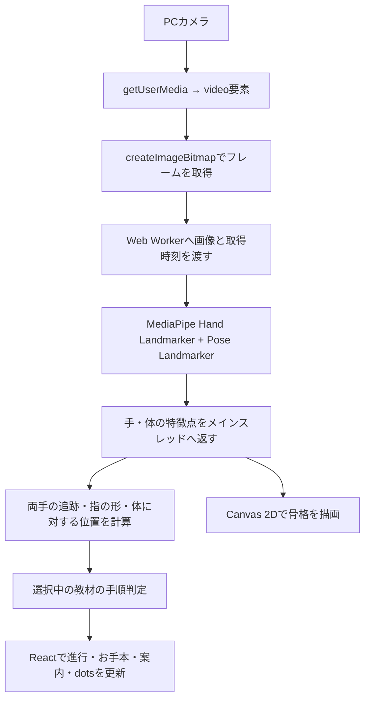

# Practice Signs with Dots

**ひとことを、手話で。** 青・緑・黄色・ピンクの4体のdotsと、「こんにちは・こんばんは・ありがとう」を練習するDevDayアプリです。

[ChatGPT Site](https://dots-sign-yurin-devday.yurinakanishi33.chatgpt.site) · [GitHub](https://github.com/yurinakanishi/practice-signs-with-dots)（どちらも本人限定）

## 使い方

ことばを選び、お手本を見て、「カメラで練習する」を押します。顔・肩・両手を映して、dotsの一言に沿ってまねしてください。左右どちらの手でも練習できます。

画面はこの練習だけです。カメラを始めると、3段階の「できた・いまここ・つぎ」と「ステップ 1 / 3」を表示し、お手本が判定に連動します。検出した手の数と、その段階に必要な手の数を別々に表示します。2つの手の骨格は青・黄色で描き分けます。形を少し保つと次へ進み、一瞬の検出漏れでは今の段階で待ちます。

**できたステップは、次の動きでつまずいても消えません。** 時間制限はなく、手を下ろしたり、カメラを止めたりしても同じステップから続けられます。「ステップ1はできたよ」と今やる動きを分けて表示し、停止中は「ここから再開」「ステップ2から再開する」のように再開位置を示します。同じことばを押し直しても進行は変わりません。

映像や認識が遅れた場合は「認識を待っています」と表示し、古い骨格を消して待機します。長く途切れた場合は、今の動きの始点だけを「ステップ3の準備」などとして案内します。完了済みのチェックは残ります。8秒間の映像停止・無応答ではカメラを解放し、続きから再開できます。進行を消すのは「最初から」「もう一度」、別のことばへの変更、ページの再読み込みです。ページを閉じた後まで記録を保存する機能はありません。

学習記録、達成率、サイドメニュー、別画面の設定はありません。練習を始める前は、お手本を一時停止したり手順を押して確認できます。途中でカメラを止めた場合は、再開するステップのお手本を表示します。OSの「動きを減らす」設定では自動再生しません。

## 技術構成

2026-10-18時点の実装と `package-lock.json` に基づきます。

構成の中心は **React + TypeScript + MediaPipe + 独自の手順判定** です。MediaPipeの学習済みモデルが手や体の特徴点を推定し、その座標を独自のプログラムで調べて、選択中の教材の条件を満たしたか判断します。

| 領域           | 使用技術                           | このアプリでの役割                                 |
| -------------- | ---------------------------------- | -------------------------------------------------- |
| 画面           | React、TypeScript                  | 教材選択、進行表示、お手本、カメラ、応援メッセージ |
| カメラ入力     | ブラウザ標準のMediaDevices API     | PCカメラから映像を取得                             |
| 手・体の検出   | MediaPipe Tasks Vision             | 手の21点と体の33点を推定                           |
| 推論の実行     | Web Worker、WebAssembly            | 画面処理と別のスレッドでモデルを実行               |
| 手話の練習判定 | 独自のTypeScriptコード             | 指の形、手の向き・位置、動作の順序を確認           |
| 骨格の表示     | Canvas 2D                          | カメラに重ねて両手の骨格を描画                     |
| お手本・dots   | SVG、PNG、CSSアニメーション        | 手順の模式図、まばたき、つぶれ、ジャンプ、成功演出 |
| ビルド         | Vite、TypeScript                   | 配布用の静的ファイルを生成                         |
| 検証           | Vitest、Playwright、GitHub Actions | 判定ロジック、ブラウザ操作、ビルドを確認           |
| 配信           | ChatGPT Sites                      | `dist/` を静的サイトとして配信                     |

## 使用ライブラリとバージョン

以下は調査対象の `package-lock.json` に記録された確定バージョンです。`package.json` の許容範囲とは区別しています。例えばReactの指定は `^19.2.0`、lockfileで確定している版は `19.3.1` です。

### アプリで使う直接依存

| npmパッケージ                       | 確定バージョン | 用途                                              |
| ----------------------------------- | -------------- | ------------------------------------------------- |
| `react`                             | `19.3.1`       | 画面をコンポーネントに分け、表示状態や操作を管理  |
| `react-dom`                         | `19.3.1`       | Reactの画面をブラウザのDOMへ描画                  |
| `@mediapipe/tasks-vision`           | `0.10.32`      | Hand Landmarker / Pose Landmarkerと、その実行環境 |
| `lucide-react`                      | `0.468.0`      | カメラ、再生、停止、チェックなどのアイコン        |
| `@fontsource-variable/dm-sans`      | `5.3.0`        | 英字用の可変フォントを同じ配信元から提供          |
| `@fontsource-variable/noto-sans-jp` | `5.3.1`        | 日本語用の可変フォントを同じ配信元から提供        |

### 開発・テスト用の直接依存

| npmパッケージ          | 確定バージョン | 用途                                     |
| ---------------------- | -------------- | ---------------------------------------- |
| `typescript`           | `5.9.3`        | 型検査。`strict: true` を有効化          |
| `vite`                 | `7.3.7`        | 開発サーバー、更新の即時反映、本番ビルド |
| `@vitejs/plugin-react` | `5.2.0`        | ViteでReact / TSXを扱うためのプラグイン  |
| `vitest`               | `5.0.5`        | 手話の判定・追跡・段階保持の自動テスト   |
| `prettier`             | `3.9.10`       | ソースコードやMarkdownの整形             |
| `@types/node`          | `24.19.2`      | Node.js APIの型定義                      |
| `@types/react`         | `19.3.0`       | Reactの型定義                            |
| `@types/react-dom`     | `19.3.0`       | React DOMの型定義                        |

ブラウザの操作検証には **Playwright / `@playwright/cli`** も使用しています。これは検証時に実行するツールで、このリポジトリの `package.json` の直接依存には含まれていません。アプリの実行には不要です。

## カメラから判定までの流れ



### カメラ取得と処理の負荷管理

- `navigator.mediaDevices.getUserMedia()` でカメラを取得。希望解像度は **1280 × 720**、希望フレームレートは **30fps** です。実際の取得条件は機器とブラウザに依存します。
- マイクは `audio: false` で要求しません。
- `requestVideoFrameCallback()` と `getVideoPlaybackQuality()` を使い、映像の新しいフレームが届いているか確認します。
- 推論用フレームの送信間隔は最短 **65ms**。カメラの30fpsと推論の実行頻度は別です。
- 処理中は次の画像を送らず、同時に待つ推論結果を1件に制限します。古い画像を大量に待ち行列へ積まない構成です。
- `ImageBitmap` をWorkerへ転送し、処理後は `close()` で解放します。
- 推論には反転前の画像を使い、ユーザーに見せる映像と骨格を鏡表示にします。

カメラ利用にはHTTPSまたはlocalhostと、ブラウザでのカメラ許可が必要です。

### Web WorkerとWebAssembly

`public/vision-worker.js` が、MediaPipeのJavaScriptとWASMを読み込みます。ここでのWorkerは **ブラウザのWeb Worker** です。

同じ画像・同じ時刻に対して手モデルと体モデルを順に実行します。設定は `runningMode: 'VIDEO'`、`delegate: 'CPU'`。推論をメインスレッドから分離することで、画面操作とモデル処理を切り分けています。

## 使用しているAIモデル

| モデル               | 配布バージョン                       | 出力・用途                                                    | 設定                                                 |
| -------------------- | ------------------------------------ | ------------------------------------------------------------- | ---------------------------------------------------- |
| Hand Landmarker      | `hand_landmarker / float16 / 1`      | 手ごとに21点の画像座標、3Dのworld座標、左右分類とスコアを取得 | `numHands: 2`、検出・存在・追跡のしきい値は各 `0.5`  |
| Pose Landmarker Lite | `pose_landmarker_lite / float16 / 1` | 体の33点を取得し、鼻・目・肩を位置の基準に利用                | `numPoses: 1`、検出・存在・追跡のしきい値は各 `0.65` |

両方ともGoogleが配布する学習済みモデルです。このアプリ向けにモデルの追加学習やファインチューニングは行っていません。

モデルの取得先は `scripts/vision-models.mjs` で固定し、ダウンロードしたファイルを **SHA-256** で検証します。`npm ci` / `npm install` の `postinstall` でモデルとMediaPipeの実行ファイルを準備し、起動・ビルド前にも必要なファイルを確認します。

実行時はモデル、WASM、フォントをアプリと同じ配信元から取得します。カメラ画像をGoogleのAPIへ送って推論する処理はありません。

`0.5` や `0.65` はモデル出力を採用するためのしきい値です。「手話を50%・65%の精度で認識する」という意味ではありません。

## 手話の動きをどう判定するか

### 特徴点から手の状態を計算

独自実装の `geometry.ts` で、モデルの座標から次の値を計算します。

| 計算する情報                     | 方法・目的                                                     |
| -------------------------------- | -------------------------------------------------------------- |
| 指が伸びているか・曲がっているか | 3Dの関節角度と、指先までの直線距離 / 骨の長さの比を使用        |
| 手のひらの向き                   | 手首と指の付け根から法線ベクトルを計算                         |
| 指のおじぎ                       | 人差し指の曲がり方と、付け根に対する向きを確認                 |
| 手の位置                         | 両肩の中点を原点、肩幅を単位として正規化                       |
| 額の位置                         | 両目の中点から肩幅に応じて上側へずらして概算                   |
| 検出を使えるか                   | 座標が有効か、手が画面内か、手や肩幅が小さすぎないかなどを確認 |

関節が重なって角度を計算できない場合は「不明」として扱います。計測できない指を、曲がった指として成功判定には使いません。

### 両手を別々に追跡

`handTracking.ts` は、手首・指の付け根の位置、短い速度予測、左右分類を組み合わせて、前のフレームと現在の手を対応付けます。

`Left` / `Right` という分類だけを手のIDにはせず、それぞれに `trackId` を割り当てます。ほぼ同じ位置の重複検出を除き、最大2本を追跡します。短時間見えなくなった手の内部トラックは最大1秒保持しますが、見えていない手を検出済みとして補完はしません。

### 3段階の順序判定

`recognition.ts` の `SignRecognizer` が、選択中の教材の内部状態を管理します。これは「いま確認している動き」を切り替える **状態機械（ステートマシン）** です。

| 教材       | ステップ1                      | ステップ2                                  | ステップ3                        |
| ---------- | ------------------------------ | ------------------------------------------ | -------------------------------- |
| こんにちは | 人差し指と中指を額付近へ       | 胸の前で両手の人差し指を立てる             | 両方の人差し指を曲げる           |
| こんばんは | 顔の左右に両手を開く           | 両手の左右の相対位置が入れ替わるように交差 | 両手の人差し指を立ててから曲げる |
| ありがとう | 片手の甲を上にして水平に構える | もう片方の開いた手を小指側から近づける     | 下の手を保ち、上の手を上げる     |

通常の形は **320ms以上かつ3フレーム以上** 保つと確定します。交差の確認は180ms、最後の動作は240msで、いずれも3フレーム以上が必要です。動画の最後の形だけを見せても、必要な始点や順序を省略して完了にはしません。

対象は、選んだ3教材の指定動作です。自由な手話の文章を理解・翻訳する機能は実装していません。また、「手をのせる」判定は座標と向きによる近接の推定で、物理的な接触を測定するセンサーはありません。

## 進行表示と途中再開

判定器では、現在の動き `phase` と、完了した段階数 `completedSteps` を分けています。

- 次の形がうまくできなくても、完了した段階は減りません。
- カメラ停止や認識の中断でも、同じページ内の進行を保持します。
- 動作の始点を確認し直す場合は `preparing` を使い、「ステップ3の準備」などと案内します。
- `Feedback` の `step`、`completedSteps`、`demoFrame` を使って、チェック・現在位置・お手本を同期します。
- 形を保つ時間を細いバーで表示します。このバーは正答確率ではありません。
- 「最初から」「もう一度」、別の教材への変更、ページの再読み込みで進行をリセットします。

Reactの `useState`、`useRef`、`useEffect`、`useCallback` を使って画面とカメラ資源を管理しています。別の状態管理ライブラリは導入していません。

### 遅延・停止への対応

取得から **500ms以上** 経過した結果や、処理中の取得時刻と一致しない応答を採用しません。更新が止まった場合は古い骨格を消し、形を保った時間の加算も止めます。

長い検出切れや急な位置変化では、今の動きの開始位置を確認し直します。完了済みのチェックは保持します。映像停止・推論無応答が8秒続いた場合は、カメラとWorkerを解放します。

この遅延管理、処理中1フレームの制限、計測不能な指の扱いは、ユーザー指定の `CRO-MAGNON` の実装を参考にしています。CRO-MAGNONをnpmライブラリとして読み込んでいるわけではありません。

## dotsとお手本の描画

### 4体のdots

青はお手本の隣、緑はカメラの下、黄色はことばの見出し、ピンクはヘッダーに配置しています。

各キャラクターは、**背景透過PNGの体 + SVGの目・小物 + CSSアニメーション** で構成しています。

| 要素                               | 実装                                                   |
| ---------------------------------- | ------------------------------------------------------ |
| ふわふわした体                     | 開発時に作成した4枚のRGBA PNG                          |
| 目・瞳・ベレー帽・眼鏡・サングラス | 独自のSVGレイヤー                                      |
| まばたき・呼吸                     | CSSの `@keyframes`                                     |
| しゃがみ・ジャンプ・着地のつぶれ   | CSSの拡大縮小・移動を組み合わせたアニメーション        |
| 視線                               | Pointer EventsとCSS変数でポインター位置に追従          |
| 押す・離す                         | Pointer Eventsで押下状態を管理し、離したときにジャンプ |
| 手順成功のお祝い                   | 完了段階が増えたときに、星と吹き出しを一度表示         |
| キーボード操作                     | ボタンとしてSpace / Enterに対応                        |
| 動きを減らす設定                   | `prefers-reduced-motion` に対応                        |

クッションのような変形は、CSSで作った動きです。物理シミュレーションエンジンや3Dモデルは使用していません。dotsをクリック・タッチした反応と、カメラで手話の段階が成立した反応を接続しています。

体の画像は、ユーザー提供の参考画像をもとに、開発時に内蔵の画像生成ツールで作成しました。アプリ実行中に画像を生成する処理はなく、公式dots SDKを利用した実装でもありません。

### 手話のお手本

`SignDemo.tsx` に独自の人物・手のSVG模式図とポーズを定義しています。練習前は約1.65秒ごとにポーズを切り替え、練習中は判定器が指定したポーズを表示します。

お手本は録画動画やモーションキャプチャーデータではなく、あらかじめ定義した模式図です。

## データ処理・バックエンド・配信

| 項目                            | 現在の実装                                                     |
| ------------------------------- | -------------------------------------------------------------- |
| カメラ画像・手や体の座標        | ブラウザ内で処理。アプリからサーバーへ保存・送信する処理はなし |
| 学習進行                        | ページ内のメモリで保持。ページを閉じた後の永続保存はなし       |
| データベース                    | 未使用                                                         |
| アプリ独自のAPIサーバー         | なし                                                           |
| アプリ独自の認証処理            | なし。サイトへのアクセス制御はホスティング側の設定             |
| OpenAI API / GPT / Realtime API | アプリ実行時には未使用。APIキー不要                            |
| Node.js                         | 開発・ビルド・モデル取得・CIに使用。CIではNode.js 24を指定     |
| 本番配信                        | Viteが生成する `dist/` をChatGPT Sitesで静的配信               |

モデル・WASM・画像・フォントなどの配信には通常のネットワークアクセスがあります。カメラ画像を使った推論処理は端末内で実行します。

`.openai/hosting.json` は `static.directory: "dist"` を指定しています。GitHub Actionsは検証用で、現在の `ci.yml` に本番デプロイ処理はありません。

静的出力は `dist/`。カメラにはlocalhostまたはHTTPSが必要です。`.openai/hosting.json` の既存Site IDを再利用し、ビルドと同じコミットをSitesへpush・保存・デプロイします。GitHubへのpushだけではSitesへ自動反映されません。Sitesの短期認証情報は保存しません。

## ローカル起動

Node.js 22.12以上（CIでは24を使用）、PC版Chrome / Edgeを使用してください。

```powershell
git clone https://github.com/yurinakanishi/practice-signs-with-dots.git
cd practice-signs-with-dots
npm ci
npm run dev
```

表示された http://127.0.0.1:5173/ を開きます。APIキーは不要です。初回インストールでGoogle公式のHand LandmarkerとPose Landmarker Liteを取得します。URLのバージョンとSHA-256を固定しています。取得に失敗した場合は `npm run models:setup` を実行してください。

モデル、WASM、フォントはアプリと同じ配信元から読み込みます。カメラ映像や手・体の座標はブラウザ内で処理し、保存・送信しません。マイクも使用しません。新しい版では学習記録を読み書きしません。旧版の記録がブラウザに残っていても利用しません。

## テストと確認できている範囲

| 検証         | 使用技術・対象                                                                       |
| ------------ | ------------------------------------------------------------------------------------ |
| 判定ロジック | Vitest。合成骨格で順序、左右反転、両手追跡、欠落、計測不能な指、途中再開などを検査   |
| 型とビルド   | `tsc -b`、`vite build`                                                               |
| ブラウザ操作 | Playwright。教材切替、カメラ開始・停止、表示同期、レスポンシブ表示、dotsの反応を確認 |
| モデルの動作 | 公式テスト画像などを実際のWorkerとモデルへ入力して確認                               |
| CI           | GitHub Actionsでpush / pull request時に `npm ci` と `npm run check` を実行           |

既存の検証記録では **75件の自動テスト、TypeScriptの型検査、本番ビルドが成功** しています。これは合成骨格などを使った実装の検証で、実利用者の手話動画に対する認識率を示すものではありません。

実映像でのPrecision / Recallや誤成功率は未測定です。表情・口形・頭の会釈の正誤判定は実装していません。教材の専門家レビュー、複数の照明・距離・利用者での認識精度測定も今後の課題です。既知の検証上の制約を含む詳細は `docs/QA.md` に記録しています。

## 検証・ビルド

```powershell
npm run check
npm run preview
```

ブラウザ確認の再実行は、開発サーバーと専用の検証ブラウザを使います。

```powershell
node scripts/download-test-assets.mjs
npx --yes --package @playwright/cli playwright-cli -s=greetings open http://127.0.0.1:5173/ --browser chrome
npx --yes --package @playwright/cli playwright-cli -s=greetings run-code --filename=scripts/verify-model.cjs
npx --yes --package @playwright/cli playwright-cli -s=greetings run-code --filename=scripts/verify-two-hands.cjs
npx --yes --package @playwright/cli playwright-cli -s=greetings run-code --filename=scripts/browser-smoke.cjs
npx --yes --package @playwright/cli playwright-cli -s=greetings run-code --filename=scripts/verify-progress.cjs
npx --yes --package @playwright/cli playwright-cli -s=greetings run-code --filename=scripts/verify-tracking-recovery.cjs
npx --yes --package @playwright/cli playwright-cli -s=greetings run-code --filename=scripts/verify-characters.cjs
npx --yes --package @playwright/cli playwright-cli -s=greetings run-code --filename=scripts/verify-checkpoints.cjs
npx --yes --package @playwright/cli playwright-cli -s=greetings close
```

## ソースを読むときの入口

以下のパスはリポジトリのルートを基準にしています。

| ファイル                                         | 内容                                           |
| ------------------------------------------------ | ---------------------------------------------- |
| `package.json` / `package-lock.json`             | 依存ライブラリ・実行コマンド・確定バージョン   |
| `src/App.tsx`                                    | 画面全体、教材の選択、進行とカメラの接続       |
| `src/hooks/useHandCamera.ts`                     | カメラの取得・停止、Worker、フレームの更新監視 |
| `public/vision-worker.js`                        | 手・体のモデル初期化と推論                     |
| `src/lib/geometry.ts`                            | 指の角度、手の向き、体を基準にした座標         |
| `src/lib/handTracking.ts`                        | 最大2本の手の対応付け・追跡                    |
| `src/lib/recognition.ts`                         | 教材ごとの順序判定、完了段階の保持、復帰       |
| `src/lib/frameTiming.ts`                         | 推論結果の鮮度判定                             |
| `src/lib/drawing.ts`                             | 手の骨格をCanvasへ描画                         |
| `src/lib/lessons.ts`                             | 3つの教材、手順、案内文                        |
| `src/components/PracticeProgress.tsx`            | 完了・現在・次の段階を表示                     |
| `src/components/SignDemo.tsx`                    | 手話のお手本のSVGとポーズ                      |
| `src/components/Dot.tsx` / `Dot.css`             | 4体のdotsの表示とインタラクション              |
| `scripts/setup-vision.mjs` / `vision-models.mjs` | モデル・WASMの準備とSHA-256検証                |
| `tests/*.test.ts`                                | 判定と進行の自動テスト                         |
| `scripts/verify-*.cjs` / `browser-smoke.cjs`     | ブラウザ・モデル・キャラクターの検証スクリプト |
| `.github/workflows/ci.yml`                       | GitHub Actionsの検証設定                       |
| `.openai/hosting.json`                           | ChatGPT Sitesの静的配信設定                    |
| `docs/RECOGNITION.md`                            | 教材と判定方式の根拠、CRO-MAGNONを参考にした点 |
| `docs/CHARACTER_ASSET.md`                        | キャラクター素材の作り方と出典                 |
| `docs/QA.md`                                     | 実施済みの検証と、未確認・未解決の事項         |

## 教材・素材・ライセンス

教材は[秋田市「手話を覚えよう！」](https://www.city.akita.lg.jp/kurashi/shogaifukushi/1006373/1004961.html)の表現を基準にしています。手話には地域・世代による違いがあります。表示する図は独自に作成した模式図で、自然な表現にはろう者・手話講師の確認が必要です。[調査と設計](docs/RECOGNITION.md)に根拠と限界を記載しています。

独立したハッカソン用プロトタイプで、dotsアカウントやAPIには接続していません。応援は練習状態に応じた定型文です。[素材と加工プロンプト](docs/CHARACTER_ASSET.md)・[第三者の素材・ライセンス](THIRD_PARTY_NOTICES.md)も参照してください。
